# Thaw on the Thoth

*A story of two boys, one Martian canal and the spring thaw of 2097. The engineering in it is real: the canal model, the two engines and every number on every chart come from runs of EPA SWMM 5.2.4 and swmm524-fvlink, both rebuilt with Mars gravity. The people, the colony and the night of the thaw are invented. The afterword sorts one from the other.*

## I. Spring on the Thoth

Ben Corliss read the basin gauge at six every morning, and in thaw season his son read it with him. A man who keeps a basin learns to trust two pairs of eyes over one.

"Eight and a half," Dan said. "A hair over."

"Write eight point five." His father did not look up from the log. "Then the time. Then your initials. If anything goes wrong this week, somebody will read that line at a hearing, and they will want to know who wrote it."

Dan wrote it. Colony Basin lay below them in the half dark, thirty-four acres of water held behind a levee of packed regolith fourteen and a half feet high. Past the far bank the greenhouse domes of Lower Town were still unlit. The town had been built on the low ground under the levee because the low ground held the night warmth best, and because the Company's engineers had said the basin would never come within a foot of the top.

The sun came up the way it always does on Mars: small and white, with a cold blue glow around it, as if somebody had turned the sky inside out. Dan had been born under that sky and had never thought it odd until Raffi Haddad, two years off the ship from Earth, told him that on Earth the sky is blue all day and the sunrise is red. Dan still suspected Raffi of pulling his leg about the red.

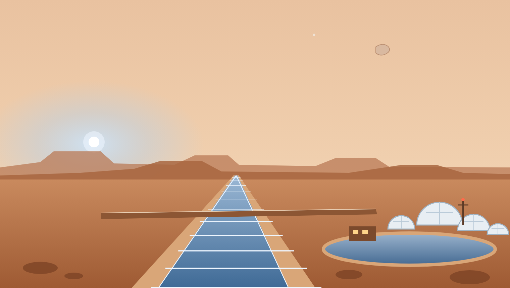

The speaker on the gauge-house wall clicked. "Mile One to Basin. Six o'clock reading."

"Go ahead, Mile One."

"Three point two feet."

Ben Corliss wrote it down. Then he looked at the Company sheet pinned beside the log. With three hundred cubic feet per second coming down the Thoth, the sheet said, the water at mile one should stand two point four feet deep.

"That's eight-tenths of a foot," Dan said.

"New lining, new gauges. The survey crew hasn't set the gauge zeros on the new work yet. Mr. Abernathy says it's the zero." He said it the way a man repeats something he has been told twice.

### The canal

The Thoth was older than anybody on Mars could account for. The first colonists found it dry, a straight trench running south from the northern plains, and they did what people do with a ditch that someone else has dug: they lined it and filled it. The Upper Thoth runs eight miles from the Headworks. It is a trapezoid forty feet wide at the bed, its sides sloping out two feet for every foot of rise, its banks fourteen feet high. It falls 1.6 feet in every mile. All of it runs under a roof of clear film held up by pumped air, because open water at Martian air pressure boils and freezes at the same time and is gone either way.

At mile four the colony road crosses on a causeway, and the water passes under the road through a culvert forty feet wide and only ten feet long. At mile eight the canal drops twenty feet down the escarpment in a concrete Chute four hundred feet long. Below the escarpment it runs six more miles across the flats as the Lower Thoth, through the Lock, and into Colony Basin.

The basin has three ways out. A pump station takes 150 cfs for the town: drinking water, the greenhouses, the air plant. An overflow sill a hundred feet long, with its crest eight feet above the basin floor, lets surplus water over into the Outlet Canal and on to the Sink. And at lower mile six, on the west bank, an old iron gate eight feet high and twenty feet wide opens onto a second channel that runs west into the desert. The colonists call it the Old Canal. Nobody knows who cut it. It has been dry since before there was anyone on Mars to notice. Whatever the Company lets through that gate is gone for good, and on Mars water given away is the hardest loss there is to make up.

The Lower Thoth, the basin and the levee were new work, finished the autumn before. This would be their first thaw.

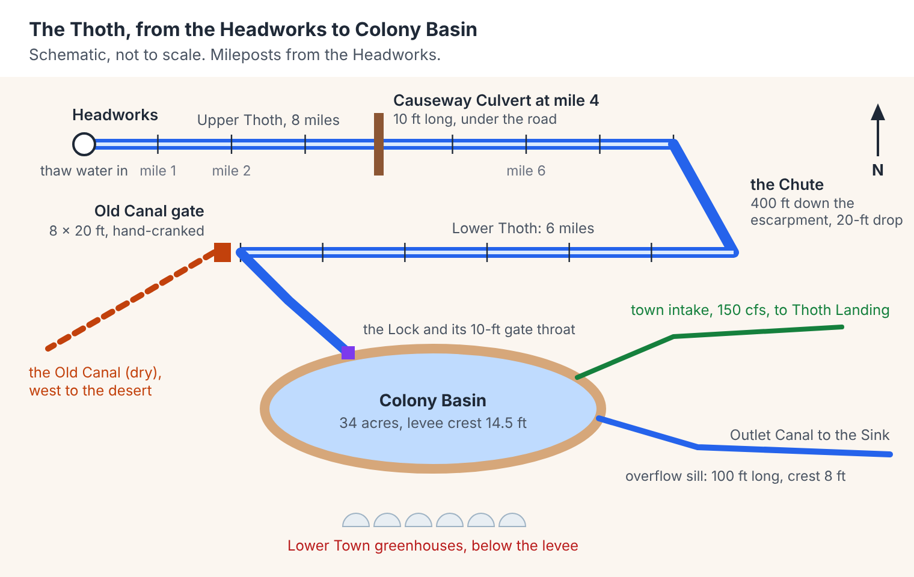

### The message from the Headworks

At seven the Headworks message came down the wire. The melt fields under the northern ice had begun to soften. Base flow of 300 cfs would hold until about midnight. After that the thaw: rising through the small hours, cresting near 4,200 cfs at six in the evening on the eleventh, and falling away over the two days after.

The Company kept its canal logs in hours counted from midnight at the start of the tenth, because its program counted time that way. In those hours the thaw would start at hour 24 and crest at hour 42.

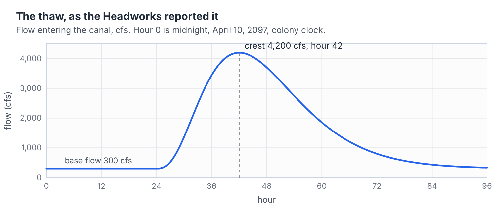

At eight the Company's forecast went up on the board outside the Canal House. It had been computed overnight on the colony's computer, which everyone called the Clerk:

> COLONY BASIN. Forecast crest 13.3 ft at hour 44. Levee crest 14.5 ft. Freeboard 1.2 ft. No action required. J. Abernathy, Chief Engineer.

Ben Corliss read it twice and said nothing, which was what he did when he did not like something and could not say why.

### Raffi

Raffi came up the levee path at a quarter past eight with his school slate under one arm and his grandfather's slide rule on his belt in a cracked leather case. He carried it everywhere. His grandfather had been a bridge engineer on Earth for forty years and had given it to Raffi on the morning the ship left, with one piece of advice: before you believe a calculation, find every constant in it and ask where it came from.

Dan showed him the two numbers, the gauge and the sheet.

"Which one's right?" Raffi asked.

"Dad says it's the gauge zero."

"Has anybody checked the zero?"

"Survey crew's on the Chute all week."

Raffi looked at the numbers for a while. Then he looked at the basin, and at the domes under the levee where his mother worked the night shift in the tomato houses.

The two of them had a school project that term from Dr. Varga, who taught mathematics and had kept canals on Mars longer than either of them had been alive. The assignment was one line long: *Model the Thoth.* Mr. Abernathy had given them a copy of the Company's model and an account on the Clerk for the evening hours, on the condition that they touched nothing that was his.

"The water's going to find out tomorrow night which number is right," Raffi said. "I'd rather we found out first."

## II. The Company Model

The Clerk lived in a cold room under the Canal House. It had been put together in the colony's second year from parts that came out on three different ships, and it ran about a thousand times slower than a good machine on Earth. Nobody minded. A canal does not change its mind quickly, and the Clerk had always been fast enough.

The program it ran was older than the colony. It was called SWMM, the Storm Water Management Model, and it had been written in 1971 for the United States Environmental Protection Agency to route rain through the sewers of Earth's cities. Its fifth version had been finished on Earth in 2005, and the Company ran build 5.2.4, the same build Earth engineers had used for decades. The source code had been public since before Raffi's grandfather was born. The Company had brought all of it.

The boys sat down at the terminal at four in the afternoon, hour 16 by the canal log, and opened the Company's model.

It was a tidy piece of work. Twenty-one conduits: eight one-mile reaches in the upper canal, the Causeway Culvert, the Chute, seven reaches in the lower canal, a ten-foot gate throat out of the Lock, the town intake channel, the Outlet Canal and the Old Canal. Twenty junctions to join them. The basin and the intake bay as storage units. A pump for the town, an orifice for the Old Canal gate, a weir for the overflow sill. The headworks hydrograph went in at the top.

"Three hours and fifty-one minutes," Raffi said, reading the run log. "For four days of canal."

"It's the Clerk."

"The Clerk does what it's told. What was it told?"

Dan scrolled to the bottom of the report. *Routing time step: 30.00 sec. Average time step: 0.27 sec. Minimum time step: 0.12 sec.*

The model had been allowed to take thirty-second steps. It had taken quarter-second steps instead, more than a hundred times as many as it was allowed.

### The clock

Dan knew why, because Dr. Varga had spent a week on it. The dynamic wave method moves every conduit and every junction forward together, one small step at a time, and it has one rule it cannot break: in a single step, no disturbance may travel farther than the conduit it is in. Water carries a disturbance downstream at its own velocity *v*. A gravity wave carries it at the speed *c* = √(*gA*/*T*), where *A* is the flow area, *T* is the width of the water surface, and *g* is the pull of gravity. So the longest safe step for a conduit of length *L* is about *L* divided by (*v* + *c*), and the program takes three-quarters of that to be careful.

The engine finds the shortest such time anywhere in the network, and every part of the network marches to it.

They worked it out for every conduit in the model. It took Raffi forty minutes with the slide rule and Dan twenty with a spreadsheet, and they got the same answers, which pleased them both.

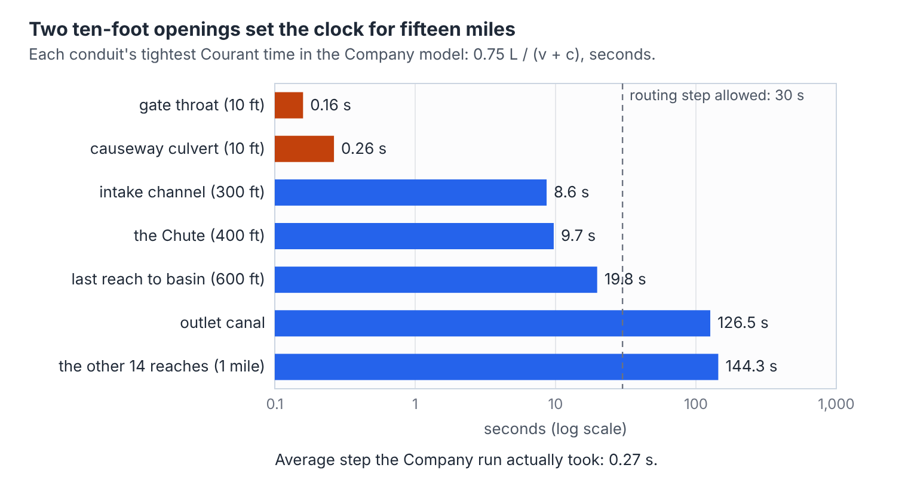

"A mile of canal could take steps of two and a half minutes or more," Dan said. "The whole upper canal. But the gate throat is ten feet long, and water goes through it fast. So everything waits on the throat."

"Fifteen miles of canal," said Raffi, "run at the speed of a doorway."

### The throat

The throat did more than slow the model down. The link summary showed it carrying 14,036 cfs at one moment on the second evening, at 27 feet per second, when the whole canal was carrying 4,200. At other moments it ran backward at more than 5,500. The report's own list of the most unstable links put the throat first, then the reach above it, then the sill.

"A ten-foot gate passing three times what the canal brings it," Raffi said. "Water doesn't do that."

"The model does."

Dan thought about it. Then he called his father on the gauge-house line.

"Dad. During thaw, what do you do with the lock gates?"

"Pin them open. Both leaves. Company rule since the basin went in. You helped me pin them Tuesday."

"So during thaw the Lock is just a corner of the basin."

"That's what I'd call it."

So they built their own version of the model, with the Lock taken out and the last reach of the Lower Thoth running straight into the basin. With the Company's constants left exactly as they were, the forecast crest came out 13.28 feet against the Company's 13.29, and the run took a little more than half as long. The throat had been costing time and buying nothing. The clock was now the Causeway Culvert alone.

That still left the gauge at mile one.

### Every constant

Their model said what the Company's said: at 300 cfs the water at mile one stood 2.38 feet deep. The gauge said 3.2. Somebody would set the gauge zero next week. The thaw would arrive tonight.

"My grandfather," Raffi said, "would say find every constant and ask where it came from."

"There are thousands of numbers in that model."

"Not in the model. In the program." He pulled the source tree up on the second screen. "Every formula for water has gravity in it somewhere. Wave speed, weirs, orifices, critical depth. If the program uses a number for gravity, it's written down someplace."

It was. It took one search.

```c
// src/solver/consts.h, line 37, EPA SWMM 5.2.4
#define   GRAVITY            32.2           // accel. of gravity in US units
```

And one more, hard-coded, with no name on it at all:

```c
// src/solver/link.c, line 1143
    aa = Conduit[k].beta / sqrt(32.2) *
         pow(Link[j].xsect.yFull, 0.1666667) * 0.3;
```


Thirty-two point two feet per second squared is how fast a dropped stone gains speed on Earth. On Mars it is 12.2.

They read the second one through. The comment above it said the flag it set had once been used by an old version of the kinematic wave method and was no longer used by anything. It was dead code: a sleeping Earth number that would not wake. The first one was very much alive. It was in the wave speed, in the momentum equation, in the friction term, in the orifice formula, in critical depth.

Dan sat back. "Every drop of water in that model," he said, "falls the way it falls on Earth."

## III. A Constant from Another Planet

Changing a constant is easy. Raffi typed 12.2 over the 32.2, added a comment so nobody would ever wonder who had done it, and rebuilt the program. It took four minutes. Then they ran their model again on the new build, every other number left the way the Company had it. On the Clerk that took most of two hours, and they spent the time eating Dan's mother's bean rolls and not talking about the levee.

At a quarter to nine the run finished, and it was wrong in two different ways.

The first way was quiet. At base flow the water at mile one still stood 2.38 feet deep, to the hundredth. Changing gravity had not moved it at all.

The second way was loud. Down at lower mile six, just above the basin, the water would not settle. Through the rise of the thaw it swung up and down without stopping, from seven and a half feet to the top of the bank and back. The flow in the last reach sloshed between 7,900 cfs forward and 2,100 backward. At hour 37.4 the water at lower mile six reached the top of the bank, and over the next hours almost 21 million gallons went over it.

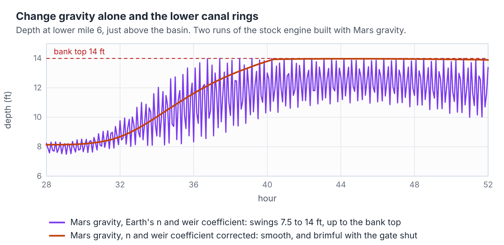

"It's the arithmetic," Dan said. "The step's too big for the slower waves, or something."

"Then make the step smaller."

They could not make it smaller cheaply, so they made it bigger and fixed: two seconds every step, no variable step at all, more than three times as long as the steps the program had been choosing. If the ringing came from the arithmetic, a coarser step should change it. It did not. The canal rang the same way and spilled 22 million gallons instead of 21.

"So it's the water," Raffi said. "Or what we told the program about the water."

Dan called Dr. Varga.

### Dr. Varga

She came down to the Clerk's room in her canal coat with a thermos, read the two numbers on the gauge-house log, read the run report, and said, "Show me the friction term."

Raffi found it. The program works out a friction factor for every conduit once, when it reads the model:

```c
// src/solver/link.c, line 1130
    Conduit[k].roughFactor = GRAVITY * SQR(roughness/PHI);
```

and then, at every step, puts friction and the downhill pull side by side in the momentum equation:

```c
// src/solver/dwflow.c, lines 214 and 217
    else dq1 = dt * Conduit[k].roughFactor / pow(rWtd, 1.33333) * fabs(v);
    ...
    dq2 = dt * GRAVITY * aWtd * (h2 - h1) / length;
```

"Look at what's in both," she said.

GRAVITY was in both. The pull of the water down the slope had GRAVITY in it, and so did the drag of the lining on the water. When the boys cut gravity to 12.2, they cut both by the same fraction. Where the two balance, in steady flow down a long reach, the balance did not move. That was why mile one still read 2.38.

"Now," said Dr. Varga. "What does a concrete wall know about gravity?"

Neither of them answered, because the answer was nothing. The drag of a lining on moving water depends on how fast the water moves past it and how rough the wall is. It does not depend on what planet the wall is on. The trouble was Manning's n, the roughness number every canal engineer learns in the first year. The Company had used 0.015 for the lining, which is the handbook value, and it is a perfectly good value on Earth. But Manning's formula was fitted to measurements made in Earth's gravity, and the square root of 32.2 is folded inside it. Keep the handbook n under Mars gravity, and the program shrinks the drag of the wall along with gravity, to 38 percent of what the wall really exerts.

"You took away five-eighths of the friction," Dr. Varga said. "Friction is what stops a canal from ringing like a bell."

To keep the wall's drag where it belongs, gravity times n squared has to stay the same. So n has to grow by the square root of 32.2 over 12.2, which is 1.625:

0.015 × 1.625 = 0.0244

"The lining hasn't changed," she said. "The number that describes it has."

### What the right n does

Raffi worked the consequences on the slide rule while Dan checked them on the screen.

Waves first. A wave in the canal travels at √(*gA*/*T*), so on Mars it travels at the square root of 12.2 over 32.2, 0.62 times as fast as on Earth, at every depth. That one did not depend on n at all.

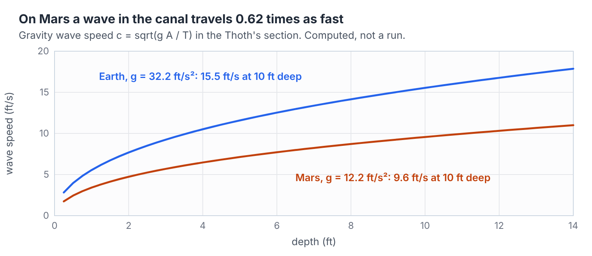

Then capacity, which did depend on n. With the handbook n the Upper Thoth carries 7,213 cfs bank-full. With the Mars n it carries 4,439. The thaw crest coming down the wire was 4,200.

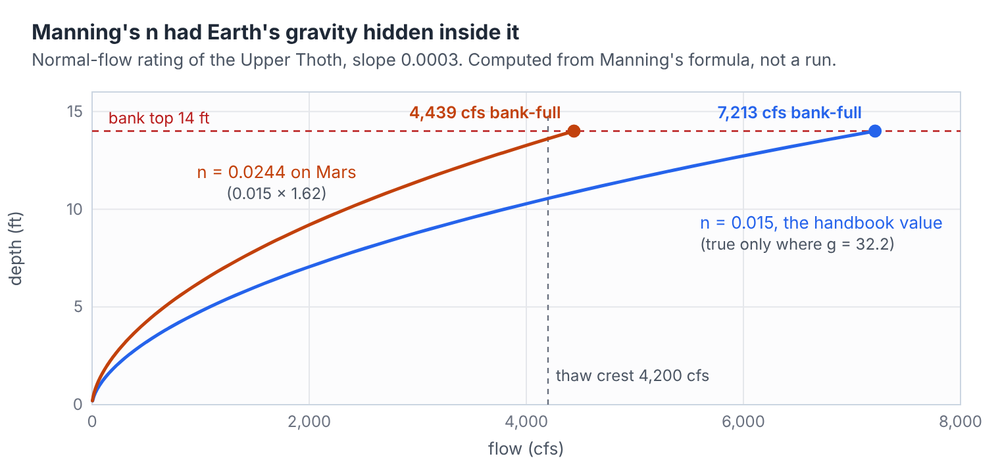

"At 300 cfs," Raffi said, and slid the cursor, "with n of 0.0244, normal depth is three point one six feet."

They both looked at the log from the gauge house. *Mile One, 0600: 3.2 ft.*

"The gauge zero was fine," Dan said. "It was fine all along."

### The sill

Dr. Varga was not finished. "Gravity is hiding in one more place. Your sill."

The overflow sill is a weir: water pours over its crest at a rate of Cw × L × H^1.5, where L is the crest length and H is the depth of water over it. Cw is the weir coefficient, and the Company had entered 3.33, another handbook number. But 3.33 is two-thirds of a discharge coefficient times the square root of 2g, with Earth's g. On Mars it has to shrink by the same square root:

3.33 × √(12.2/32.2) = 2.050

"The program doesn't fix that for you," she said. "It takes Cw as you give it."

The orifice formula for the Old Canal gate needed nothing. It builds the square root of 2g out of GRAVITY each time:

```c
// src/solver/link.c, line 1757
    f = xsect_getAofY(&Link[j].xsect, h) * sqrt(2.0 * GRAVITY);
```

### Two runs before midnight

The Clerk could run two jobs at once if nobody else wanted it, and at half past nine at night nobody did. They started two. The first was their own model, Lock merged into the basin, with n of 0.0244 and a sill coefficient of 2.050. The second was the Company's model exactly as the Company had built it, Lock and throat and all, with the same two corrections.

Their own model came back at twenty past eleven.

Mile one at base flow: 3.16 feet. The gauge said 3.2.

Mile one at the crest of the thaw: 13.54 feet. The bank was 14.

Colony Basin: at the top of the levee by hour 40.3, and then over it. Before the thaw went down, 134.8 million gallons of water would go over the levee into Lower Town.

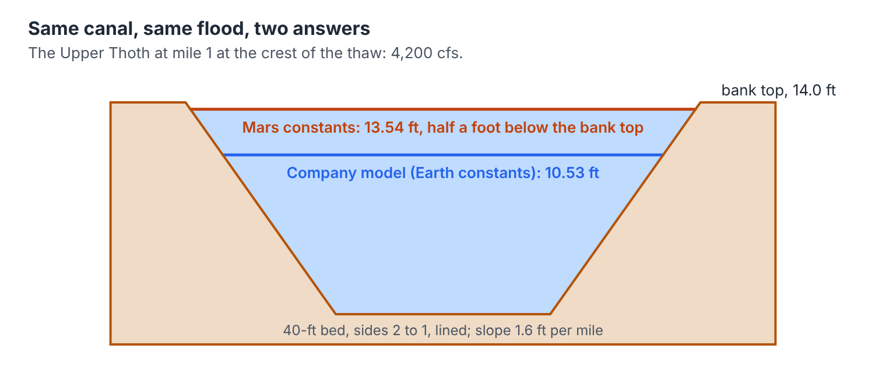

The Company's own model, corrected, had come back at about the same time. It agreed: the basin would reach the top of the levee at hour 40.3. But it said something else on the first page of its report, in the line every engineer reads first.

`Flow Routing Continuity ... Continuity Error (%) ..... -18.139`

The throat, with Mars constants, had gone from bad to impossible: 24,439 cfs at more than 50 feet per second through a ten-foot opening. The model had lost eighteen percent of its water to arithmetic. Nobody could take that run to anyone.

At midnight the Headworks called down. The thaw had begun.

## IV. Water That Ran Uphill

At a quarter past midnight Dr. Varga put the problem on the whiteboard in three lines.

*The basin goes over at hour 40.3 unless water leaves it some other way.*

*The only other way is the Old Canal gate. Four men on the handwheel, two hours to open.*

*Every plan takes one run, and one run takes an hour and forty-eight minutes.*

"Mr. Abernathy will want to see more than one plan," she said. "He will want to see what happens if you are wrong about the sill, and what happens if the Headworks is wrong about the thaw. Say six runs. That is eleven hours on the Clerk, one after another. You have perhaps twelve hours before somebody has to start turning that wheel, and you will want to show him something long before that." She capped the pen. "And he will ask why you took his Lock out of his model, and you cannot answer him with a run that loses eighteen percent of its water."

"Then we need a faster program," Raffi said, "that can handle a ten-foot throat."

"There is one," said Dr. Varga. "Or there may be."

### One pipe on its own clock

Years before, an engineer on Earth had published a branch of SWMM 5.2.4 called swmm524-fvlink. Dr. Varga had a copy for teaching. It left the dynamic wave method alone everywhere except on links the modeler chose by name in a new section of the input file, `[FV_LINKS]`. On those links it used a different method altogether, the finite volume method that river engineers use for floods and dam breaks.

A finite volume link is cut lengthwise into cells. The water in each cell is a volume, and between cells the program computes a flux: how much water, and how much momentum, crosses each face in each instant, worked out by solving the small problem of two different bodies of water meeting at a wall that has just been pulled away. The link runs its own small substeps inside each step of the network and hands its flows back to the nodes at the ends when it is done. The ten-foot throat no longer sets the clock for fifteen miles. The network can stride along at the pace of its long reaches, and the short link catches up in quick little steps of its own.

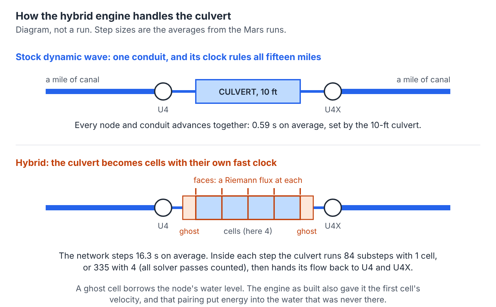

At each end of the link sits a ghost cell, a cell that is not really there. It stands in for the node on that end, so that the first and last faces have something to compute against.

Raffi rebuilt it with GRAVITY at 12.2, since the finite volume code used the same constant. Dan named the throat and the culvert in an `[FV_LINKS]` section of the Company's model, with the corrected n and sill, and started it.

### Uphill

They did not need to wait for it to finish. Dan watched the water levels go by on the screen as the run counted through the simulated hours, and before simulated hour one he said, "Raffi. Look at the Lock."

The Lock had drained. It had started the run at the basin's level, like any corner of the basin. Within the first simulated hour it had fallen six and a half feet, and by hour six it was barely half a foot deep. By hour 24 the Lock held 0.63 feet of water over its floor. Colony Basin, on the other side of the ten-foot throat, stood 7.7 feet higher. And the throat was carrying 300 cfs at 11.9 feet per second, out of the Lock and *into* the basin.

The model had water running seven feet uphill, all day, at the full flow of the canal.

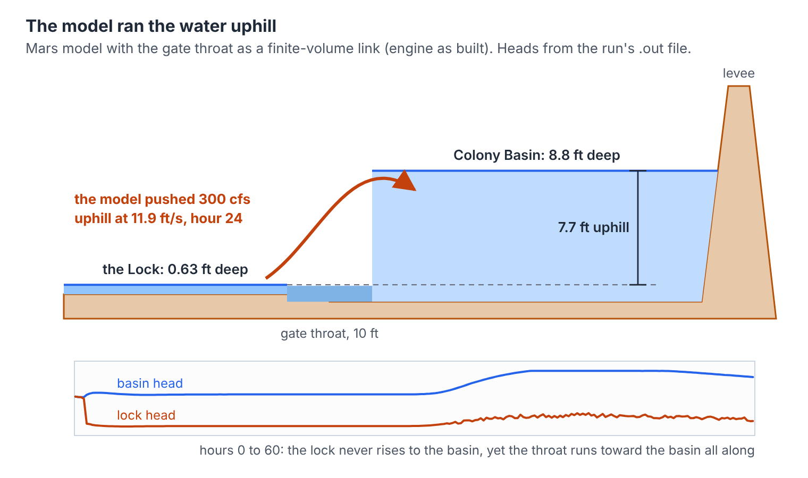

"Well," said Dr. Varga, after a while. "That's not the canal."

"Then it's the program," Raffi said. "And it's at the ends of the link, because that's the only place the throat touches anything."

He opened the finite volume source and found the routine that computes the flux at a face. At the first face of a link, m is zero; at the last face, m equals nc, the number of cells. This is what it said:

```c
// src/solver/fvlink.c, faceFlux(), swmm524-fvlink as published
    // --- left state
    if ( m == 0 )
    {
        zL = f->z1;
        etaL = hd1;
        hL = MAX(0.0, etaL - zL);
        uL = velOf(f, f->a[0], f->q[0]);
    }
    ...
    // --- right state
    if ( m == nc )
    {
        zR = f->z2;
        etaR = hd2;
        hR = MAX(0.0, etaR - zR);
        uR = velOf(f, f->a[nc-1], f->q[nc-1]);
    }
```

He read it aloud, slowly, because he wanted to be sure. At the upstream end the ghost cell takes its water level, `etaL`, from the node's head, `hd1`. That is right; the ghost is supposed to stand in for the node. But it takes its velocity, `uL`, from the link's own first cell. The Lock's water was nearly still. The throat's water was moving at 11.9 feet per second. The ghost was handed the Lock's level and the throat's speed together, as if the Lock were full of water already racing toward the gate.

"A level and a speed are energy," Raffi said. "The level was the Lock's. The speed wasn't." He set the slide rule. "Eleven point nine feet per second, on Mars. U squared over 2g is five point eight feet. Five point eight feet of head the Lock never had."

And it fed itself. Each substep the throat's speed went into the ghost, came back out of the flux as more speed, and went into the ghost again. The jet made its own head. With nothing in the scheme to say otherwise, it pushed the Lock's water over into a basin seven feet higher and kept the Lock nearly empty while the basin filled.

### A fix, and why they didn't use it

Raffi wrote a fix by two in the morning. His ghost took its state from the node's energy instead of its level: the water entering the link could have only the head the node actually had, shared out between depth and speed by Bernoulli's rule. He rebuilt the engine and ran the Company's model again, throat and culvert both in `[FV_LINKS]`.

The jet was gone. The throat's flow no longer leapt and fell; it ran quiet. But at base flow the Lock still stood two feet below the basin while 300 cfs ran out of it into the basin. Less uphill was still uphill. And when the thaw came through, the fixed engine choked both short links. The culvert passed at most 3,412 cfs of the 4,200 coming down at it, the canal backed up behind the causeway, and the upper canal went over its banks at mile four: 199 million gallons. The lower canal went over at mile six, 256 million more.

Raffi stared at it for a long time.

"I treated every node like a still pool," he said finally. "At the Lock that's almost true. At mile four it isn't. The water is already moving at four and a half feet a second when it reaches the culvert, and it speeds up to nearly eight going through. My ghost threw the approach speed away and made the water buy all eight feet a second out of its depth. On Mars that costs two and a half feet of head."

Then he did the thing his grandfather would have made him do. The hybrid engine came with its own set of test networks and the answers they were known to give. He ran them all.

Every test network with water flowing into a finite volume link came out different. The node at the upstream end stood higher than before, in every case by about one velocity head. In a straight thirty-conduit test chain, the junction at the inflow end of the finite volume link rose 0.77 feet, at every mesh size they tried. In a seventy-conduit chain it rose three and a half feet. It was the same mistake, made politely, everywhere.

"The engine as built pushes water uphill at a still pool," Raffi said. "My fix holds water back in a moving canal. They're wrong in opposite directions."

He opened the defect register that came with the engine: a plain list of every bug its builder had found and fixed, each one with the code as it had stood. The first entry, FVL-1, was Raffi's own mistake, made by somebody else first. The earliest draft of the engine had given the ghost cell no velocity at all, a still pool at both ends of every link, and water leaving a link had backed up against it. The cure had been to give the ghost the cell's velocity. That cure was the code on the screen that had just run water uphill.

"Same question both times," Raffi said. "How fast is the water moving just before it gets into the link? Zero is wrong in a canal. The link's own speed is wrong at a pool. The right answer is the node's speed, and in this program a node doesn't have one."

"Can you fix the fix?" Dan asked.

"Not tonight. Not well enough to bet Lower Town on it."

Dr. Varga said nothing. She had learned long ago that the best thing to say to a student who has just reached the right conclusion is nothing.

So they backed the fix out. Raffi wrote the defect down instead, as the next entry in the engine's own register, FVL-15, in the register's own form: what the code did, the lines that did it, the uphill run, the fix he had tried and what it broke, on Mars and in the test suite. Then he sent it to the engineer on Earth who had built the branch. The message would take most of a quarter of an hour to reach Earth, and it would be morning there before anybody read it.

That settled the Lock as well. They could not model the throat honestly on Mars with either engine that night. What they had was the Company's own rule, gates pinned open in thaw, and the Earth check: with the Company's own constants, merging the Lock into the basin had moved the forecast by one hundredth of a foot. They would use the merged model, and they would say in writing that the throat was the one thing in it nobody had been able to test on Mars.

That left one short link: the Causeway Culvert. It had a full mile of canal on each side, deep water moving at much the same speed in and out, nothing like a doorway into a still pool. If the hybrid engine could be trusted anywhere, it could be trusted there. But that was a claim, and claims cost runs.

It was four in the morning, hour 28. The thaw at the Headworks had passed 700 cfs and was still climbing.

## V. Nothing Is Free

They put the hybrid engine to work on the culvert at four in the morning, and it promptly made things worse.

They had named the Causeway Culvert in `[FV_LINKS]` and let the engine cut it into its default of four cells, each two and a half feet long. Their own merged model, Mars constants, no other change. On the Clerk's second processor, at the same time, they ran something that looked pointless: the hybrid engine on the same model with the `[FV_LINKS]` section taken out, so that it had no finite volume links at all.

The four-cell run took two hours and thirty-seven minutes. The plain dynamic wave run had taken an hour and forty-eight.

"It's slower," Dan said. "We used the fast engine and it's slower."

"It isn't a fast engine," Raffi said. "It's an engine with a different bill. Read the bill."

The report had a table at the bottom for every finite volume link. The network had walked through the thaw at an average step of 16.3 seconds, more than twenty-seven times the 0.59 seconds the plain engine had managed. That was the part that had been promised. But inside every one of those long steps, the culvert had run 335 substeps, counting every pass the solver made, because a cell two and a half feet long still has to obey its own clock. Over four simulated days the network took about twenty-one thousand steps, and the culvert took about seven million substeps inside them. Four short cells had cost more time than the long steps saved.

"Nothing is free," said Dr. Varga, from the chair by the heater where they had thought she was asleep. "You bought fewer steps in the network and paid for them in the culvert. Now find the right price."

They cut the culvert to one cell, all ten feet of it, and ran again. The network still averaged 16.3-second steps. The culvert now needed 84 substeps per step instead of 335, and its smallest substep was a quarter of a second instead of six-hundredths.

The run took twenty-three minutes.

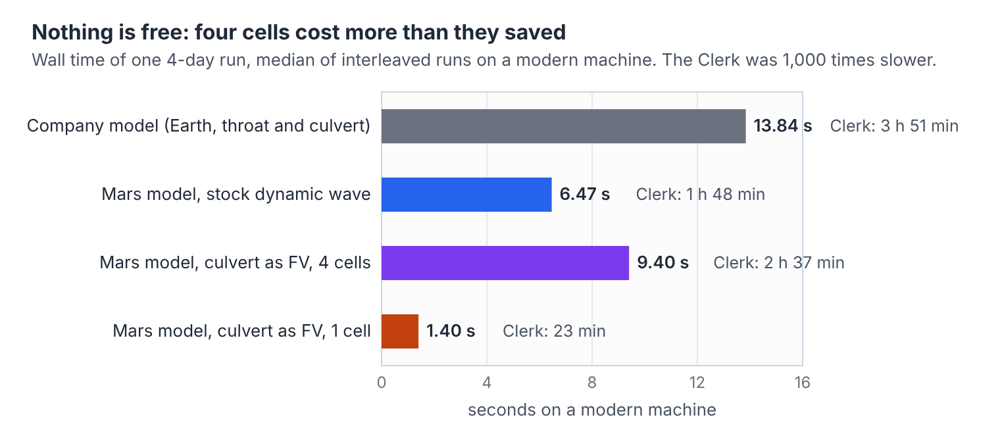

### Is one cell enough?

Twenty-three minutes was the number they needed: six plans in a little over an hour, two at a time. But a fast answer is worth nothing until somebody shows it is the same answer, and Dr. Varga made them show it three ways before she would let them call it a result.

**The null check.** The run on the second processor, the hybrid engine with no finite volume links, had finished at a quarter to six. If the new engine did anything at all to a model when it was told to do nothing, that run would show it. They compared its output file against the plain engine's, byte by byte. Both were 1,273,166 bytes long, and every byte was the same. The reports matched line for line except for the clock times on the last page.

**The culvert itself.** The finite volume link keeps its own books: the water stored in the link at the end of each step, against the water that crossed its two end faces. With one cell the books balanced to a trillionth of a percent, and with four cells better still. Upstream of the culvert, at mile four, the highest water of the thaw was 13.27 feet in the plain run, 13.27 with four cells and 13.27 with one. Whatever the end of a finite volume link did wrong at the Lock, it was doing nothing measurable here.

**The basin.** The plain engine had the basin at the top of the levee at hour 40.3, with 134.8 million gallons over it before the thaw went down. The one-cell run had it there at hour 40.4, with 134.3 million.

"Five minutes and half a million gallons," Dan said, "out of a hundred and thirty-four million."

"Two engines, one answer," said Raffi. "That's what we take to Mr. Abernathy."

### Seven o'clock

At seven, hour 31, the mile-one gauge called in to the basin and Ben Corliss relayed the number down the line. The thaw was coming through at a little under 1,700 cfs.

"Seven point nine," he said.

Their model said 7.94 feet at mile one at hour 31. The Company's model, with Earth's constants, said 6.23.

Ben Corliss was quiet on the line for a moment. Then he said, "Abernathy's in at eight. I'll walk up with you."

## VI. Margin

James Abernathy had built canals in three deserts on Earth before the Company brought him out, and he had kept the Thoth for nine years without losing a foot of levee. He was not a man who liked being told his model was wrong by two schoolboys at eight in the morning. He was also not a fool, and he knew the difference between not liking a thing and its not being so.

He listened to the whole of it without interrupting. Then he asked his questions, one at a time, in the order an engineer asks them.

"The gauge."

Dan gave him the two readings. Mile one at base flow, 3.2 feet; the Company's model said 2.38, theirs said 3.16. Mile one at seven this morning, 7.9; the Company's model said 6.23, theirs 7.94.

"Your n."

Raffi gave him the argument and the number. Abernathy took a pad and worked it himself, the long way, from Chézy's coefficient and the friction factor, with a pencil. It took him six minutes. He put the pencil down.

"I've used 0.015 for that lining for twenty years," he said. "On Earth." He looked at the pad a while longer. "The weir too, then. Go on."

"You took my Lock out of my model."

They told him why: the gates pinned open by his own rule, the Earth check that moved his crest by a hundredth of a foot, the Mars run that lost eighteen percent of its water at the throat, the hybrid run that sent water seven feet uphill there. They told him about Raffi's fix and what it did, and why they had not used it.

"So on Mars," Abernathy said, "neither of your engines can tell me what that throat does."

"No, sir."

"Then how do you know it doesn't matter?"

"We don't," Dan said. "That's the one thing we couldn't test. If the open lock gates hold the water back harder on Mars than on Earth, the danger is in the lower canal just above the Lock, not in the basin. We'd put a man with a radio on the bank at lower mile six. And whatever we do with the Old Canal gate takes water off the canal right there."

Abernathy wrote that down. "And this new engine of yours."

The null check, byte for byte. The two engines, plain and hybrid, five minutes and half a million gallons apart out of a hundred and thirty-four million.

He sat back. "So the levee goes over at about hour 40," he said, "unless water leaves this system some other way. And the only other way is the Old Canal." He did not say it happily. "Every acre-foot through that gate goes into the desert. The town draws about three hundred acre-feet a day. Tell me how little I can get away with."

### Runs before noon

They had the hybrid engine with one cell in the culvert, twenty-three minutes a run, two runs at a time. Abernathy gave them the Canal House's own terminal and stood behind them while they ran.

The first question was *when*. The gate takes four men two hours to open. The model opened it all at once at a chosen hour, held it full open, and shut it at hour 56. They tried the hour.

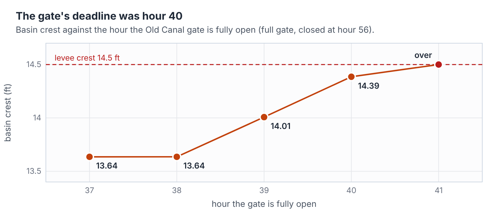

Full open by hour 37 or 38: crest 13.64 feet. By 39: 14.01. By 40: 14.39, a tenth of a foot from the top. By 41 it was too late: the basin went over, five million gallons into Lower Town.

"Full open by thirty-eight," Abernathy said, "means the crew starts at thirty-six. Noon." He looked at the clock. It was a few minutes before ten.

The second question was *how much*. Abernathy wanted the gate half open. Half open from hour 38 to hour 52 spilled 853 acre-feet and kept the basin at 14.32 feet, eighteen hundredths below the crest. Opening it half way two hours earlier, at 36, spilled more water and bought nothing at all: the crest came later, after the thaw had peaked, and it was the same 14.32. Full open from 38 to 52 spilled 1,443 acre-feet and held the crest at 13.98, half a foot down. Full open from 38 to 56 spilled 1,830 acre-feet and held it at 13.64.

"Eighteen hundredths of a foot," Abernathy said. "Two inches. It's enough, if your numbers are right."

"That's the next question," Raffi said. "What if they aren't?"

### Two doubts

They picked the two numbers in the model they trusted least.

The first was the sill. Its coefficient, 2.050, was an Earth handbook number scaled for Mars by a square root. Nobody had ever measured the sill. They ran every plan again with the sill five percent weaker than they had assumed.

The second was the thaw itself. The 4,200 cfs crest was the Headworks' forecast, and the Headworks had missed by ten percent before. They ran every plan again with the thaw ten percent bigger, a crest of 4,620.

Six more runs, three pairs. It was half past eleven when the last one came back.

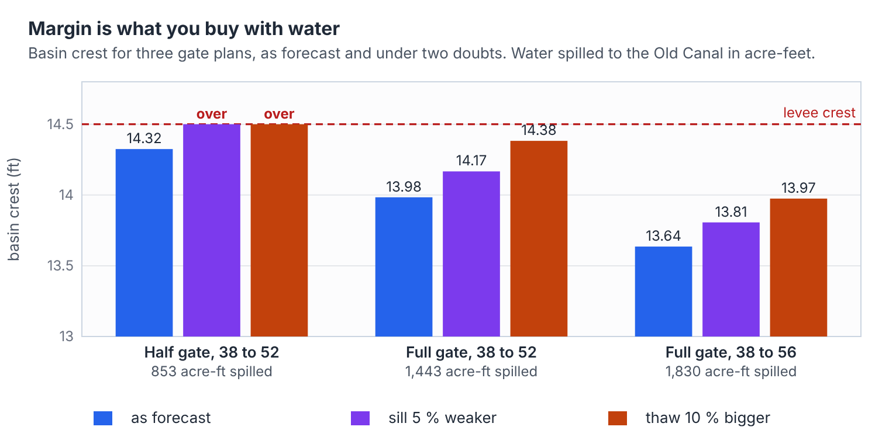

The half gate failed both. With the sill five percent weaker the basin went over the levee. With the thaw ten percent bigger it went over by 21 million gallons.

Full open from 38 to 52 held under both: 14.17 feet with the weaker sill, 14.38 with the bigger thaw.

Full open from 38 to 56 held under both by more: 13.81 and 13.97.

That afternoon, while the gate was opening, they also ran the canal's roughness five percent below 0.0244 and five and ten percent above it. It hardly mattered. With the gate full open from 38 to 52 the crest stayed between 13.97 and 14.03.

Nobody had run both doubts at once. There had not been time, and Dan said so.

### The decision

"If I take the half gate and you're right," Abernathy said slowly, "I save 590 acre-feet. Two days of the town's water. If I take the half gate and the sill is five percent weak, or the Headworks is ten percent low, Lower Town floods in the night." He did not need to say who lived in Lower Town. "If I take the full gate and you're wrong the other way, I've thrown away two days of water."

He turned to Ben Corliss, who had been standing by the door the whole time.

"Ben. Can your crew have the Old Canal gate full open by hour 38?"

"If we start at noon."

"Start at a quarter to. Full open, hold it to hour 52, then close it." He wrote it in the log in ink and signed it. "One thousand four hundred and forty-three acre-feet," he said, reading the number off the screen as he wrote it, as if he wanted to remember the price. "Nearly five days of everything this town drinks, grows and breathes."

"Margin is what you buy with water," Raffi said, and then looked as if he wished he had not said it out loud.

Abernathy looked at him for a moment. "Yes," he said. "It is." Then: "Run the plan on the plain engine too. I want two answers before dark."

That afternoon the plain engine said 13.99 feet for the same plan. The hybrid had said 13.98.

## VII. What the Instrument Said

The Old Canal gate had not been opened in nine years except to test it. Ben Corliss's crew started on the handwheel at a quarter to noon, four men in pressure suits on a platform over the canal, two on the wheel and two resting, changing every ten minutes. The gate came up a quarter of an inch a turn.

At first nothing happened that anyone could see. Then the water found the bottom edge of the gate, two feet above the canal bed, and went through it in a flat brown sheet, and the dry channel on the other side began to fill for the first time since before anybody had been on Mars to watch it.

By hour 38 the gate was full open, and the Old Canal was taking a little over twelve hundred cubic feet per second off the Lower Thoth, a third of what the thaw was bringing down. At the basin gauge Dan read 13.5 feet, wrote it down with the time and his initials, and watched the number stop climbing.

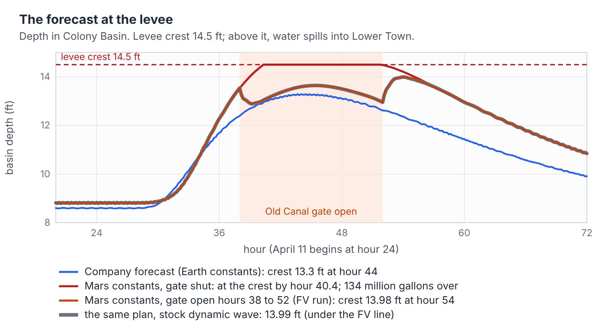

### Hour 40.3

Hour 40.3 was twenty past four in the afternoon. It was the hour the model had said the water would reach the top of the levee if the gate stayed shut. Raffi and Dan were on the levee crest at the gauge house, with Dr. Varga, Ben Corliss, and, to everybody's surprise, Mr. Abernathy, who had walked down from the Canal House without saying why.

The gauge read 13.0.

Nobody cheered. There was nothing yet to cheer about. The thaw at the Headworks would not crest for nearly two hours more, and the water from that crest would take hours more to come down fifteen miles of canal. But the basin was falling while the canal was rising, which is what a basin does when somebody has given it another way out.

The man on the bank at lower mile six called in every half hour. The lower canal there rose to within six-tenths of a foot of the top of its bank and no closer.

### Night

The sun went down blue at a little after six, and the cold came in behind it. Phobos came up in the west, the way it always does, because it goes around Mars faster than Mars turns. Lower Town's greenhouse lights came on one dome at a time under the levee. Raffi's mother walked out of the tomato houses at the end of her shift and waved up at the gauge house, and Raffi waved back and did not tell her anything.

Through the evening the basin climbed slowly back up as the crest of the thaw came down the canal: 13.3 at six, 13.6 by eight, and there it held until after ten. The model had said 13.63 at hour 46, ten at night.

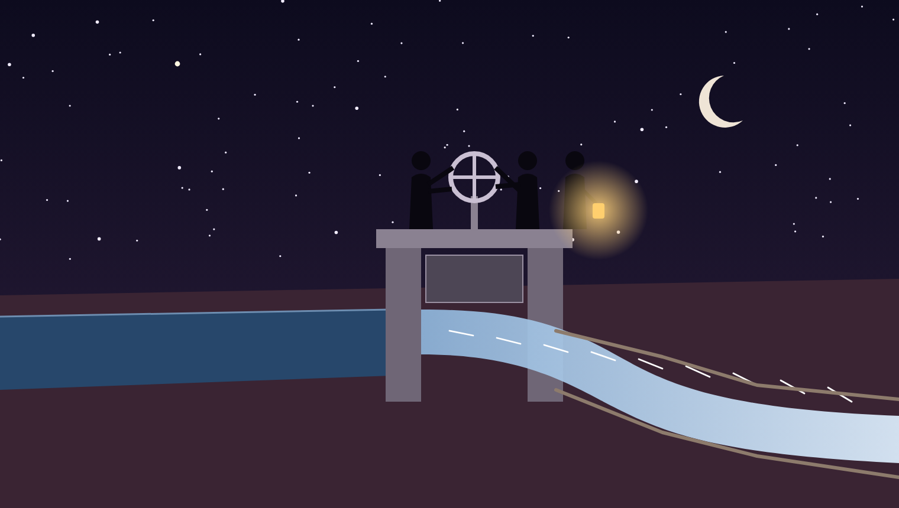

At hour 52, four in the morning, the thaw at the Headworks was down to about 3,100 cfs and falling. That was the hour on the order. Ben Corliss's crew went back out by lantern light and began to close the gate, a quarter inch a turn, and Dan went down to the basin gauge, because this was the part of the plan that made him most nervous. Closing the gate meant taking away the basin's other way out while the last of the thaw was still coming in. The model said the basin would rise again for two hours after the gate closed, to its highest point of the whole thaw.

It did. At six in the morning, hour 54, Dan read the gauge in the half dark, exactly forty-eight hours after he had read it with his father on the morning of the tenth.

"Thirteen point nine," he said.

"Write it down," said his father. "Then the time. Then your initials."

The model had said 13.98 at hour 54. The levee was 14.5. Half a foot of margin, bought with 1,443 acre-feet of water, and nothing in Lower Town wet but the tomatoes.

### The specification

Mr. Abernathy called them up to the Canal House at nine. He had the forecast board taken down and a clean one put up in its place, and he handed Raffi the marker.

"Write down what your instrument is," he said. "Then what you checked, and how. Then what you didn't. Every forecast this Company posts from now on carries all three, and it starts with yours."

This is what went up on the board, in Raffi's hand, with Dan reading the numbers out to him from the run log.

> **THE INSTRUMENT.** EPA SWMM 5.2.4 and swmm524-fvlink, both rebuilt with GRAVITY 12.2. The Thoth model with the Lock merged into Colony Basin, as it stands with the lock gates pinned open. Manning's n 0.0244, sill coefficient 2.050, both scaled from Earth handbook values for Mars gravity. The Causeway Culvert as one finite volume cell; everything else dynamic wave.
>
> **CHECKED.** n against the mile-one gauge at two flows: 3.2 ft read, 3.16 ft modeled at base flow; 7.9 ft read, 7.94 ft modeled at hour 31. The hybrid engine with no finite volume links gives an output file identical to the plain engine's, byte for byte. Plain and hybrid engines agree at the basin within 0.01 ft. The culvert's own volume balance closes to about a trillionth of a percent. The highest water upstream of the culvert is the same, 13.27 ft, in the plain engine and the hybrid with one cell or four.
>
> **NOT CHECKED.** The sill coefficient has never been measured. Five percent weaker was tested; nothing weaker was. The thaw is the Headworks forecast. Ten percent bigger was tested; nothing bigger was. The two doubts were never run together. The roughness was tested five percent low and ten percent high and hardly mattered, but it was checked against only one gauge. The Lock and its gate throat could not be modeled honestly on Mars by either engine, so the head lost through the open lock gates is left out. The model opens and closes the Old Canal gate all at once at hours 38 and 52; the crew took two hours each way. Evaporation and seepage under the roof are not in the model. The model follows the Old Canal for 2,000 feet and no farther.
>
> **KNOWN DEFECT, FVL-15.** In swmm524-fvlink as published, the ghost cell at the inflow end of a finite volume link takes the node's water level but the link's own velocity. Fed from a still pool, it runs water uphill. Do not put a finite volume link at the outlet of a pool until this is fixed. Reported to Earth.

Mr. Abernathy read it twice, top to bottom. Then he signed it under Raffi's last line, and he made Dan and Raffi sign it too.

"The old board said *No action required*," he said. "I wrote that. It was a true statement about my model. It was not a true statement about the canal." He capped the marker. "A model is an instrument, gentlemen. You don't trust an instrument. You calibrate it, and then you write down what it can't see."

### The Old Canal

The survey crew went west along the Old Canal that afternoon to see where 1,443 acre-feet of water had gone.

Four miles out, where the model had stopped following it long before, the old channel opened into a broad round hollow nobody had mapped, its floor and walls laid in fitted stone. The water was there, nearly all of it, under a skin of new ice, held as neatly as if somebody had built the hollow to hold exactly that.

Perhaps somebody had. Nobody on Mars could say. Dr. Varga stood at the rim for a long time with her hands in her coat pockets.

"They knew about thaws," she said at last. "Whoever they were."

Dan thought about that on the long walk back. He thought that the builders of the Old Canal had probably had their own Clerk, or something like it, and their own constants written in their own handbooks, and that somebody among them had sat up all night once, checking where every one of them came from.

## Afterword: what is real in this story

The engineering is real. The people, the colony and the night of the thaw are not.

**The canal.** The Thoth is an invented canal, made for this story by a short script, `gen_thoth.py`, that writes a SWMM5 input file. About fourteen miles of trapezoidal main canal (fifteen miles of conduit in all, with the outlet and side channels): eight one-mile reaches above a 10-ft causeway culvert and a 400-ft chute with a 20-ft drop, six one-mile reaches and a 600-ft reach below, a 34-acre storage basin with its levee crest at 14.5 ft, a 100-ft overflow weir, a pumped town intake, and an 8 by 20 ft side orifice onto a dry channel. The thaw is a smooth hydrograph from 300 cfs to 4,200 cfs. There is no survey behind any of it.

**The engines.** EPA SWMM 5.2.4, built from the EPA source at commit `7952ca8`, and swmm524-fvlink, Bob Dickinson's branch of the same code that solves chosen links by the finite volume method. For Mars, both were rebuilt with one change: `GRAVITY` in `consts.h` set to 12.2 instead of 32.2. The code quoted in Chapters II and III is copied from the EPA source as it stands. The code in Chapter IV is copied from swmm524-fvlink as published.

**The numbers.** Every model result in the story, from the Company's 13.29-ft crest to the 13.98 ft at hour 54, comes from a run of one of those engines on the Thoth model, and the story says which engine each time. The scaling of Manning's n (×1.625) and the weir coefficient (×0.6155) for Mars gravity is a dimensional argument: hold the wall's drag fixed, which means holding g·n² fixed, and let the weir coefficient carry its √(2g). It is ordinary reasoning, but nobody has measured flow in a lined canal on Mars, so it has never been checked against data.

**The figures.** Nine charts come from run output: the Courant times, the ringing canal, the cross-section depths, the uphill throat, the run times, the forecast at the levee, the gate clock, the plans under doubt, and the thaw hydrograph, which is the model's own input. Two are computed from formulas and say so: wave speed and the Manning rating. The map and the finite volume diagram are drawings. The three paintings were drawn for the story as vector art.

**The run times.** Each was measured on a modern machine as the median of five interleaved runs: 6.47 s for the plain engine, 9.40 s with four finite volume cells in the culvert, and 1.40 s with one. The four-cell engine took 1.45 times as long as the plain one, with pairs ranging from 1.39 to 1.58. The one-cell engine took 0.217 times as long, with pairs from 0.21 to 0.26. The Company's model took 13.84 s. The Clerk is fiction, and its times are those times a thousand.

**The water that ran uphill.** This is real. It turned up while the model for this story was being built, exactly as Chapter IV tells it. The lines shown are the lines in the published branch. The uphill run's numbers come from that run. Raffi's fix is a real prototype written during the same work, and its results on Mars are real runs. Its test-suite shifts are real too (the junction in the thirty-conduit chain rose 0.77 ft; in the seventy-conduit chain the rise was 3.5 ft), though the test networks were run at Earth gravity. Three other prototypes were tried as well, and none fixed the throat without changing results elsewhere. FVL-1, the earlier still-pool choke, is a real entry in the branch's defect register. FVL-15 has now been added beside it. The engine itself has not been changed. Whether and how to fix it is the branch owner's decision.

**What is invented.** Thoth Landing, the Canal Company and everyone in it. The Clerk. The gauge readings, which were set near the model's values for the same hours. The Headworks' track record. The builders of the Old Canal and their stone hollow.

**Red Planet.** The premise, boys at a colony on Mars working out the flow in its canals, is a salute to Robert A. Heinlein's 1949 novel *Red Planet*. No character, place or line of text is taken from it.

**The code.** The engine, its documents and the whole Thoth model are on the `swmm524-fvlink` branch of [SWMMBobSWMM6/Stormwater-Management-Model](https://github.com/SWMMBobSWMM6/Stormwater-Management-Model/tree/swmm524-fvlink). The canal is in `examples/thoth-mars`. That folder holds the generator, the one-line gravity patch, every input file and report behind the story, the scripts that drew the figures, and this story's text.

## Use of AI

This story and everything behind it were made with Claude, Anthropic's AI model, in a Claude Code session in October 2026, at the request of Robert (Bob) Dickinson. Bob asked for a story about boys on Mars modeling canal flow in the spirit of *Red Planet*, set the house style for explaining engineering, and is responsible for what is published.

Claude did the following:

- designed the Thoth canal and wrote its generator
- rebuilt both engines with Mars gravity
- ran every model in the story: the Company case, the gravity-only and corrected cases, the uphill throat, the scenarios and sensitivity runs, and the timing runs
- found the uphill defect, traced it to the lines shown, and wrote and tested the prototype fixes
- worked out the scaling of n and the weir coefficient
- drew all the charts, diagrams and paintings
- wrote the story

The checks are mechanical. Every number in the text was traced to a run's output file or to a stated formula. The null check is a byte-for-byte comparison of two output files, and the two engines were compared at the basin. The timings are medians of interleaved runs.

No person has yet reviewed the story or rerun the models. No other engineer has checked the n and weir scaling, and no data from Mars exists to check it against.
